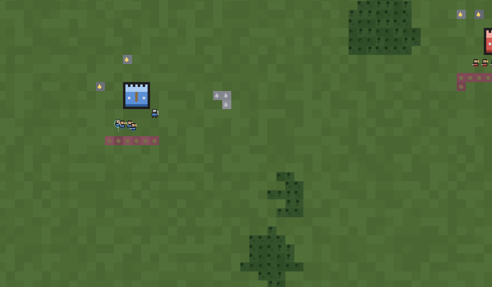

# AoE2 Mini — Dark Age prototype

A browser-playable Age of Empires II prototype as a plain static page — no build step,
no framework, no dependencies, one PNG of unit art. Open `index.html` and play.

**Live:** https://barf-bot.github.io/aoe2-mini/



## What's in it

- Procedural map: grass, water, forest, berry bushes, gold and stone deposits, drawn from the
  palettes in `src/config.js:282-291`. No fog of war yet — every tile is visible from the
  first frame (planned: `docs/ROADMAP.md` item 14)
- A Town Center with villagers that harvest → carry → deposit → retarget when a tile empties
- Buildings: house (population), farm (food field), barracks, lumber camp, mining camp, mill
  and archery range, all constructed over time with hp scaling
- Ages: Dark → Feudal → Castle, with the food costs and unlock rules
- Units: villager, militia and archer, every frame real ripped art from
  `assets/sprites.png`; training queues at the Town Center and the Archery Range, melee
  swings and arrows in flight, deaths
- Win / lose: razing the enemy Town Center ends the game with a `Victory` overlay, losing
  your own a `Defeat` one; the simulation freezes and the overlay's `New game` restarts
- Controls: click / drag-select, control groups (`Ctrl+1…9`, `1…9` to recall), right-click
  move / attack / gather, hotkeys (`H` house, `F` farm, `B` barracks, `L` lumber camp,
  `G` mining camp, `M` mill, `R` archery range, `T` age, `Esc` to cancel), minimap camera drag,
  two-finger touch pan
- An enemy village that reacts and fights back

## Known limits (it's a prototype)

- Resource objects and ground tiles are still drawn procedurally; every unit and building
  frame is real ripped art vendored in `data/sprites/` (the farm building frame excepted —
  the rip ships no farm bitmap, so that cell keeps the old procedural art)
- One simple AI opponent, no lobby/multiplayer

## Docs

| File | What's in it |
|---|---|
| [`AGENTS.md`](AGENTS.md) | rules for working on the repo (no-build constraint, where code goes, verification gate) |
| [`docs/ARCHITECTURE.md`](docs/ARCHITECTURE.md) | file map, the `Game` shape, sim/render/input models |
| [`docs/GAME_RULES.md`](docs/GAME_RULES.md) | the implemented ruleset — every stat, cost and rule, with line refs |
| [`docs/CONVENTIONS.md`](docs/CONVENTIONS.md) | naming, formatting, the feature recipe, anti-rules |
| [`docs/TODO.md`](docs/TODO.md) | known bugs in fix order, with causes and reproductions |
| [`docs/ROADMAP.md`](docs/ROADMAP.md) | prioritized next work, each with an exit condition |
| [`docs/CHANGELOG.md`](docs/CHANGELOG.md) | dated history of what shipped and what was fixed |

Start with `AGENTS.md` if you're an agent picking the repo up cold.

## What's in this repo

| Path | Purpose |
|---|---|
| `index.html` | the markup and the ordered list of scripts |
| `src/*.js`, `src/style.css` | the game: config, world, entities, sim, movement, economy, commands, ai, save, sound, render, hud, input, boot, main — see the file map in [`docs/ARCHITECTURE.md`](docs/ARCHITECTURE.md) |
| `assets/sprites.png` | the sprite atlas (1522×684): unit cells — villager idle/walk/farm_a/farm_b/chop_a/chop_b/mine_a/mine_b, militia and archer idle/walk/attack_a/attack_b, blue above red — above the building cells drawn at their footprints |
| `data/units.json`, `data/buildings.json`, `data/techs.json` | the vendored AoE2 stat tables (sources in [`data/README.md`](data/README.md)) — the only place unit/building/tech/world numbers are authored |
| `data/sprites.json`, `data/sprites/` | the vendored sprite frames (ripped AoE2 art, recoloured per team) and the atlas manifest `tools/gen-atlas.js` composes the sheet from |
| `tools/headless-check.js` | runs every file in `tools/checks/` (each in its own process, against a stub DOM) and adds up the results — 294 invariants; pass a name fragment to run a subset, `-q` for failures only |
| `tools/checks/` | the checks themselves, one independent file per topic (`node tools/checks/07-combat.js` runs one alone) |
| `tools/lib/` | `load-game.js`, the loader every tool uses (runs the scripts `index.html` lists, in the same order the browser does), and `harness.js`, the stub DOM and fixtures every check file starts from |
| `tools/check-stats.mjs` | renders `CFG`/`KINDS`/`BLD`/`TECHS` in `src/config.js` from `data/` and fails with one line per field when they drift (`--write` regenerates the blocks) |
| `tools/gen-atlas.js` | composes `assets/sprites.png` from `data/sprites.json` + `data/sprites/` and regenerates the sprite tables in `src/config.js` |
| `tools/render-preview.js` | boots the same code against a real canvas (`@napi-rs/canvas`) and writes `preview.png`, so the renderer is verified, not just assumed |
| `tools/audit-line-refs.js` | checks that every `file:NNN` reference in the docs still points at the code it names, that the documented file map matches what `index.html` loads, and that the logic files stay DOM-free |
| `preview.png` | a real frame of the game rendered headlessly |

```bash
node tools/headless-check.js        # 294/294 checks passed
node tools/check-stats.mjs          # verifies src/config.js against the vendored stat tables
node tools/audit-line-refs.js       # verifies the docs against the code
npm install --prefix tools          # once: the canvas backend the next two need
node tools/render-preview.js        # rewrites preview.png
node tools/gen-atlas.js             # composes assets/sprites.png from data/sprites/ and rewrites the tables
```

## How to run locally

Serve the folder (any static server) or just open the file:

```bash
python3 -m http.server 8080   # then visit http://localhost:8080
```

## Deployment

GitHub Pages publishes from the `main` branch root, so the repo root *is* the site.
Push a change and the live site updates a few seconds later.
